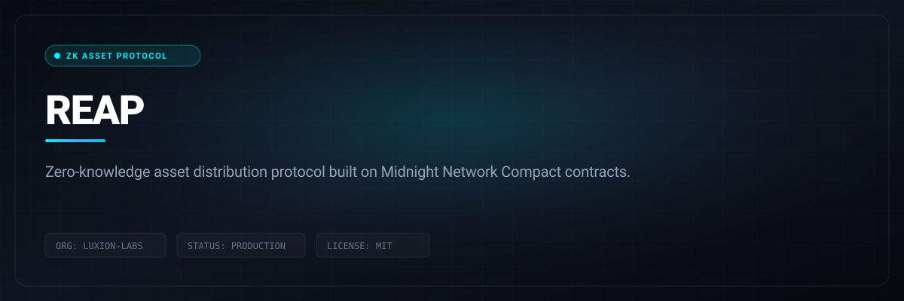

# REAP

> Zero-knowledge asset distribution protocol built on Midnight Network Compact contracts.



<p align="center">
  
  &nbsp;
  
  &nbsp;
  
  &nbsp;
  
  &nbsp;
  
  &nbsp;
  
</p>

<p align="center">
  <a href="https://reap-eight.vercel.app"></a>
  &nbsp;
  <a href="LICENSE"></a>
  &nbsp;
  <a href="CONTRIBUTING.md"></a>
</p>

---

## Quick Start & Getting Started

Getting REAP running locally takes only two steps:

```bash
git clone https://github.com/Luxion-Labs/REAP.git
cd REAP
npm install && npm run dev
```

Open [http://localhost:3000](http://localhost:3000) to access the real estate tokenization interface.

---

1. **Executive Summary**

2. **Problem & Vision**

3. **User Personas & Use Cases**

4. **Core Features**

5. **Proposed Improvements & Additions**

6. **System Architecture (Full-stack design)**

7. **9-week Product Roadmap & Task Breakdown Table (with team assignments)**

8. **Metrics of Success**

---

## ** BrickChain  -  Tokenization dApp**

**Version:** 2.0 (Post-Hackathon PRD)  
 **Duration:** 9 weeks (to evolve into a production-ready MVP)  
 **Team:**

* Athar : (Docs, Testing, Architecture, Coordination)

* Ayush: (Smart Contracts \+ ZK Integration)

* Samarth: (API & Storage Systems)

* Akshad: (React, Wallet integration, UI/UX)

---

## **1️⃣ Executive Summary**

BrickChain redefines property investment by turning real estate into **fractional, tradable digital tokens**, all while ensuring privacy and compliance through **zero-knowledge proofs**.

We aim to transition from a functional prototype to a **production-grade fullstack platform**, capable of handling real property onboarding, token minting, shielded transactions, and proof-based verifications  -  with a clean UI, documentation, and modular architecture.

---

## **2️⃣ Problem & Vision**

**Problem:**  
 Traditional real estate transactions are slow, opaque, and exclusionary. Ownership verification requires paperwork, middlemen, and trust-heavy intermediaries.

**Vision:**  
 To build a **privacy-first, decentralized property exchange** where:

* Investors can **own fractions of real property**.

* Transactions remain **private yet verifiable**.

* Ownership proofs can be **shared selectively** with regulators or partners.

---

## **3️⃣ User Personas & Use Cases**

### **Investor**

* Wants to buy fractional shares of verified properties securely.

* Needs to confirm ownership without leaking personal details.

### ** Property Owner**

* Wants to tokenize and sell property shares easily.

* Needs to prove legitimacy of property holdings privately.

### ** Regulator**

* Needs to verify proof of ownership percentage without accessing full ledger data.

**Use Cases:**

1. Register property → store proof on-chain.

2. Mint fractional tokens linked to the property.

3. Transfer tokens privately to investors.

4. Verify ownership via selective disclosure (ZKP).

---

## **4️⃣ Core Features (Current)**

 Property registration (hashed doc on-chain)  
  Fractional token minting  
  Private transfers (shielded)  
  Ownership verification via ZK proof

---

## **5️⃣ Proposed Improvements (Next 9 Weeks)**

| Area | Current | Improvement |
| ----- | ----- | ----- |
| **Architecture** | Single repo, mixed logic | Modular monorepo: `/frontend`, `/contracts`, `/backend`, `/zk` |
| **Smart Contracts** | Prototype in Midnight Compact | Add role-based access control, property metadata struct, ownership tracking, test coverage |
| **Backend** | Simple Node wrapper | Introduce service layer with property registry DB (Postgres/SQLite), ZK proof cache, API for frontend |
| **Frontend** | Basic UI | Add wallet connection, dashboard for properties, ZK verification UI, TX history, and dark theme |
| **Storage** | Local/IPFS mock | Switch to proper IPFS pinning (e.g., Web3.Storage), fallback to local DB |
| **ZK Proofs** | Manual proof calls | Automate proof generation & verification flow through backend SDK wrapper |
| **Testing & Docs** | Minimal | Full API docs (Swagger), smart contract test suite, frontend test coverage |
| **UX Additions** | Upload \+ transfer only | Add dashboard for: Owned Properties, Invested Shares, Activity Feed |
| **Security/Compliance** | Basic shielded tx | Add Proof-of-KYC stub (for future compliance), signature validation, proof verification logs |

---

## **6️⃣ System Architecture Overview**

**Frontend (React \+ Midnight.js SDK)**  
 → Connect Wallet → Register / Mint / Transfer UI  
 → Calls backend REST API for off-chain components (IPFS hashes, proof generation, etc.)

**Backend (Node.js \+ Express)**  
 → Wraps smart contracts (using SDK)  
 → Handles file hashing, ZK proof request queue  
 → Stores off-chain metadata (Postgres/SQLite)

**Smart Contracts (Midnight Compact)**  
 → Defines `Property`, `TokenFraction`, `Transfer`, `Proof` modules  
 → Shielded transfer functions  
 → Events emitted for frontend listeners

**Storage**  
 → IPFS for property documents  
 → Local DB for mappings (PropertyID ↔ Hash ↔ Owner Wallet)

---

## **7️⃣ 9-Week Product Roadmap \+ Task Breakdown Table**

| Week | Focus | Key Deliverables | Assigned  | Status |
| ----- | ----- | ----- | ----- | ----- |
| 1 | **Setup & Refactor** | Create monorepo structure (`/frontend`, `/backend`, `/contracts`, `/zk`), define .env and README structure | Samarth \+ Athar |  In Progress |
| 2 | **Smart Contract v2** | Add metadata struct, mapping for fractional tokens, events for ownership transfer | Samarth \+ Ayush | ⏳ Pending |
| 3 | **ZK Integration Layer** | Build proof generation \+ verification module (wrapping Midnight primitives) | Ayush \+ Athar | ⏳ Pending |
| 4 | **Backend API Layer** | REST endpoints: `/register`, `/mint`, `/transfer`, `/verify`, connect DB \+ IPFS | Samarth \+ Athar | ⏳ Pending |
| 5 | **Frontend Revamp** | Dashboard UI, wallet connect, property list, mint/transfer modals | Akshad \+ Athar | ⏳ Pending |
| 6 | **Testing & Docs** | Smart contract unit tests, API testing (Postman), Swagger docs | Athar \+ Ayush \+ samarth | ⏳ Pending |
| 7 | **UX \+ Proof Dashboard** | Add “View My Properties” \+ “Generate Ownership Proof” \+ TX feed | Akshad \+ Samarth | ⏳ Pending |
| 8 | **Security & Compliance Layer** | Add KYC proof stub, signature verification, logging of ZK verification | Athar \+ Ayush \+ samarth | ⏳ Pending |
| 9 | **Polish & Deploy** | Final integration, bugfixes, deploy demo (frontend \+ backend), create final presentation & docs | Athar \+ Ayush \+ samarth \+ Akshad | ⏳ Pending |

---

## **8️⃣ Metrics of Success**

| Category | KPI |
| ----- | ----- |
| **Usability** | Successful end-to-end tokenization in \< 2 mins |
| **Reliability** | 100% of ownership proofs verify successfully |
| **Privacy** | Zero data leaks in test logs |
| **Performance** | \< 3s average TX response (local testnet) |
| **Team Velocity** | 90% planned tasks completed within sprint time |

---

## **9️⃣ Deliverables (End of 9 Weeks)**

*  Fully working fullstack BrickChain MVP

*  Deployed dApp (frontend \+ backend)

*  Functional smart contracts with ZK integration

*  Documented API & test suite

*  Demo-ready pitch deck \+ product video


---

## Maintainer Response SLA
Luxion Labs enforces a strict 24-hour response SLA on all community issues, feature proposals, and pull requests. See [CONTRIBUTING.md](CONTRIBUTING.md) for full development guidelines.

## License
Distributed under the MIT License. See [LICENSE](LICENSE) for details.
